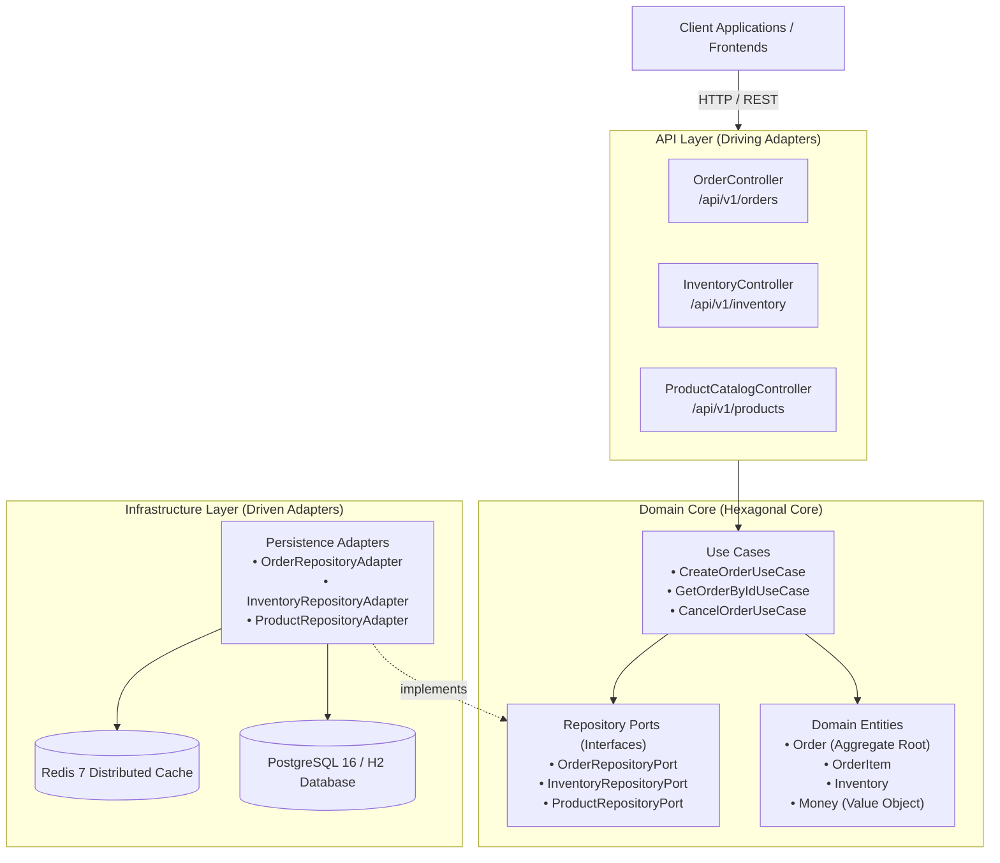

# Enterprise Order & Inventory Processing System

[](https://openjdk.org/)
[](https://spring.io/projects/spring-boot)
[](#architecture-overview)
[](https://www.postgresql.org/)
[](https://redis.io/)
[](https://www.docker.com/)
[](http://localhost:8085/swagger-ui.html)
[](LICENSE)

> Production-grade, high-throughput order processing and real-time inventory reservation engine. Architected with Domain-Driven Design (DDD), Clean Hexagonal Architecture, Optimistic Concurrency Control (`@Version`), and RFC 7807 Error Standardization.

---

## 1. System Highlights & Engineering Merits

* **Clean Architecture & Hexagonal Ports:** Core domain entities and use cases are 100% decoupled from framework dependencies and persistence adapters.
* **Race Condition Mitigation:** Employs JPA Optimistic Locking (`@Version`) and database-level Pessimistic Locking queries (`SELECT ... FOR UPDATE`) to guarantee zero overselling during high-concurrency flash sales.
* **N+1 Query Elimination:** Uses Spring Data JPA `@EntityGraph(attributePaths = {"items"})` to fetch Order aggregates and OrderItems in a single query with optimized `LEFT OUTER JOIN`.
* **Standardized REST Error Model:** Implements Spring Boot 3 `ProblemDetail` (RFC 7807 specification) for all client error payloads.
* **Instant Out-of-the-Box Execution:** Features an embedded H2 in-memory profile with seeded catalog data for rapid evaluation, alongside a production Docker Compose environment running PostgreSQL 16 and Redis 7.

---

## 2. Architecture Overview



Detailed architectural blueprints, sequence diagrams, and concurrency conflict flows are documented in [docs/ARCHITECTURE.md](docs/ARCHITECTURE.md).

---

## 3. REST API Specifications

| Method | Endpoint | Description | Status Code |
| :--- | :--- | :--- | :--- |
| `POST` | `/api/v1/orders` | Create an order and atomically reserve stock (Optimistic Locking) | `201 Created` |
| `GET` | `/api/v1/orders/{id}` | Retrieve order details by internal database ID | `200 OK` |
| `GET` | `/api/v1/orders/by-number/{orderNumber}` | Retrieve order details by public Order Number | `200 OK` |
| `GET` | `/api/v1/orders` | List all orders | `200 OK` |
| `POST` | `/api/v1/orders/{id}/cancel` | Cancel order and release reserved inventory stock | `200 OK` |
| `GET` | `/api/v1/inventory` | Inspect real-time stock levels (available vs reserved) | `200 OK` |
| `GET` | `/api/v1/inventory/{sku}` | Inspect inventory details for a specific product SKU | `200 OK` |
| `GET` | `/api/v1/products` | Browse catalog products | `200 OK` |

Interactive Swagger documentation available at: `http://localhost:8085/swagger-ui.html`

---

## 4. Quickstart Guide

### Option 1: Run with Docker Compose (Recommended)
Spins up the full stack: Spring Boot Application, PostgreSQL 16, and Redis 7:

```bash
# Clone the repository
git clone https://github.com/thienlotus/enterprise-order-system.git
cd enterprise-order-system

# Launch multi-container stack
docker-compose up -d --build
```

### Option 2: Run Locally (Maven & In-Memory H2)
Requires Java 17 LTS:

```bash
# Run with Spring Boot Maven Plugin
./mvnw spring-boot:run
```

* **API Base URL:** `http://localhost:8085`
* **Swagger UI:** `http://localhost:8085/swagger-ui.html`
* **H2 Console:** `http://localhost:8085/h2-console` (JDBC URL: `jdbc:h2:mem:orderdb`, User: `sa`, Password: empty)

---

## 5. Sample Request & Response

### Create an Order
```bash
curl -X POST http://localhost:8085/api/v1/orders \
  -H "Content-Type: application/json" \
  -d '{
    "customerEmail": "engineer@thienlotus.com",
    "shippingAddress": "123 Cau Giay District, Hanoi, Vietnam",
    "items": [
      {
        "sku": "SKU-LAPTOP-M3",
        "quantity": 1
      },
      {
        "sku": "SKU-KEYBOARD-MECH",
        "quantity": 2
      }
    ]
  }'
```

### Response (`201 Created`):
```json
{
  "id": 1,
  "orderNumber": "ORD-E38F1A92",
  "customerEmail": "engineer@thienlotus.com",
  "shippingAddress": "123 Cau Giay District, Hanoi, Vietnam",
  "status": "CONFIRMED",
  "totalAmount": 59690000.00,
  "currency": "VND",
  "createdAt": "2026-10-14T16:15:00Z",
  "items": [
    {
      "id": 1,
      "sku": "SKU-LAPTOP-M3",
      "productName": "Apple MacBook Pro M3 16-inch",
      "unitPrice": 49990000.00,
      "quantity": 1,
      "subtotal": 49990000.00
    },
    {
      "id": 2,
      "sku": "SKU-KEYBOARD-MECH",
      "productName": "Keychron Q1 Pro Mechanical Keyboard",
      "unitPrice": 4850000.00,
      "quantity": 2,
      "subtotal": 9700000.00
    }
  ]
}
```

---

## 6. Author

* **Lê Vũ Thiên** (`@thienlotus`)
* Software Engineer Intern | Core Focus: Java Enterprise, Clean Architecture & Applied AI
* Location: Hanoi, Vietnam
* Email: [thienchip1310@gmail.com](mailto:thienchip1310@gmail.com)
* GitHub: [https://github.com/thienlotus](https://github.com/thienlotus)

---

## 7. License

This project is licensed under the MIT License - see the [LICENSE](LICENSE) file for details.
