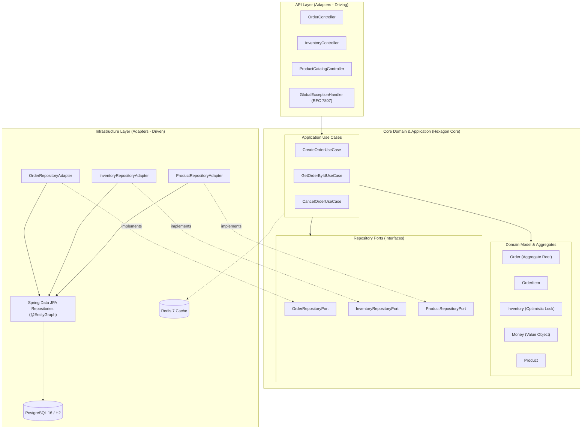
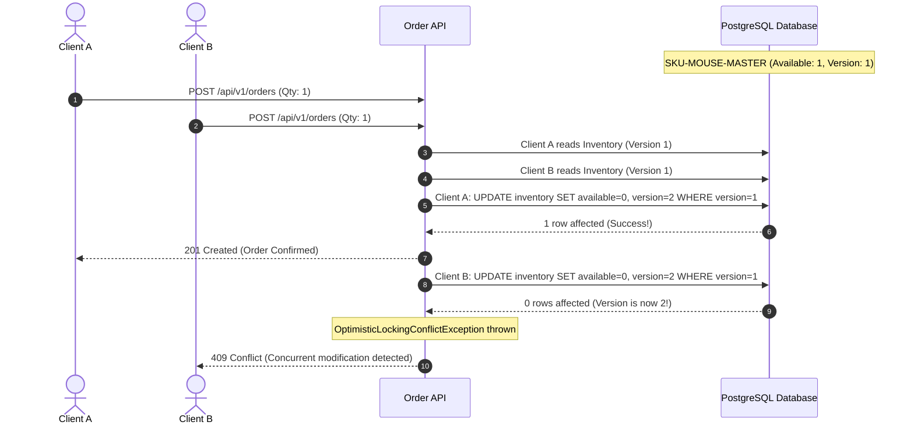

# Enterprise Order & Inventory System Architecture Documentation

> **Architect & Lead Developer:** Lê Vũ Thiên (`@thienlotus`)  
> **Frameworks:** Java 17, Spring Boot 3.2, Spring Data JPA, Redis, PostgreSQL, Docker  
> **Design Paradigms:** Clean Architecture (Hexagonal / Ports & Adapters), Domain-Driven Design (DDD), Optimistic Concurrency Control

---

## 1. Architectural Philosophy

This system demonstrates the implementation of **Clean Architecture** and **Domain-Driven Design (DDD)** applied to high-throughput e-commerce order processing. The design enforces the **Dependency Rule**: source code dependencies point strictly inward toward high-level domain policies.



---

## 2. Concurrency Management: Race Condition Prevention

In flash-sale or high-contention scenarios, multiple clients attempt to purchase the remaining stock simultaneously. Without proper concurrency controls, systems experience **phantom reads, race conditions, and overselling (negative inventory)**.

### Optimistic Concurrency Control (`@Version`)
This system utilizes JPA Optimistic Locking:
1. Every inventory row carries a `version` integer column.
2. When reserving stock, Hibernate checks: `WHERE id = ? AND version = ?`.
3. If another concurrent thread commits an update first, the version increments and the second thread's query affects 0 rows, triggering an `ObjectOptimisticLockingFailureException`.
4. Our `GlobalExceptionHandler` translates this into an RFC 7807 `409 Conflict` response with instructions for automated retry.



---

## 3. Query Optimization: Eliminating the N+1 Problem

When querying orders with their associated line items:
* **Naive Hibernate Query:** 1 query for Orders + N queries for each Order's Items = $1 + N$ SQL executions.
* **Our Solution:** Spring Data JPA `@EntityGraph(attributePaths = {"items"})` generates a single optimized `LEFT OUTER JOIN` in SQL, retrieving orders and items in **1 single database roundtrip**.

---

## 4. API Standardization: RFC 7807 Problem Details

All exceptions thrown across the domain and application layers are caught by `GlobalExceptionHandler` and mapped to RFC 7807 `application/problem+json` formatted responses:

```json
{
  "type": "https://api.thienlotus.com/errors/insufficient-stock",
  "title": "Insufficient Inventory Stock",
  "status": 422,
  "detail": "Insufficient stock for SKU SKU-MOUSE-MASTER. Requested: 15, Available: 10",
  "instance": "/api/v1/orders",
  "timestamp": "2026-10-14T16:10:00Z"
}
```
